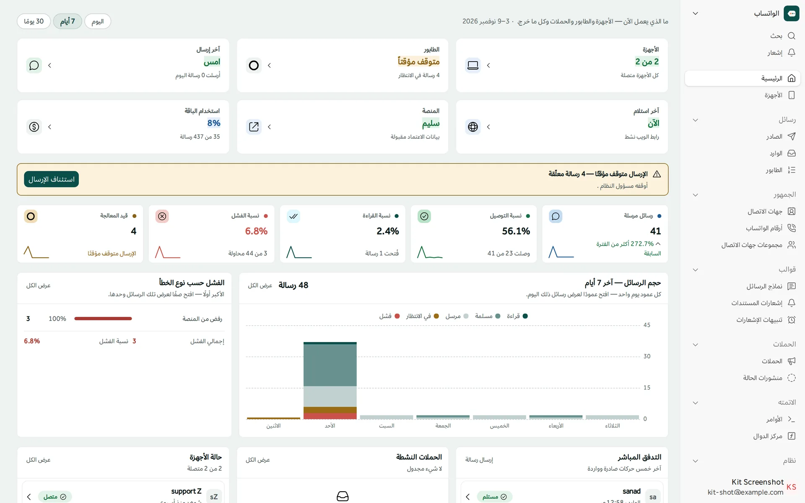
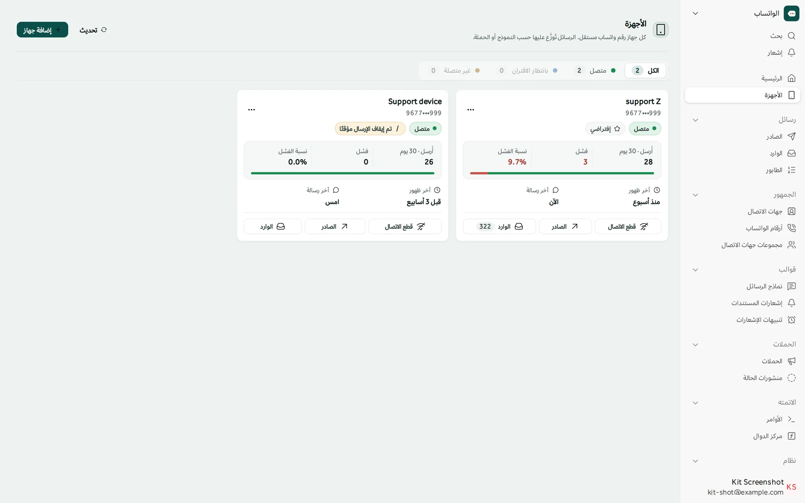
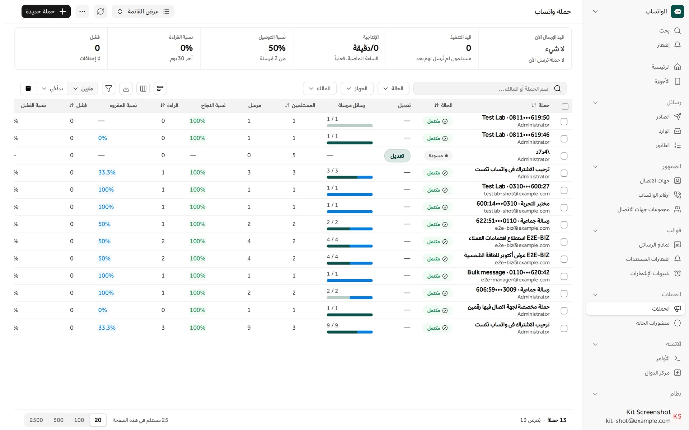
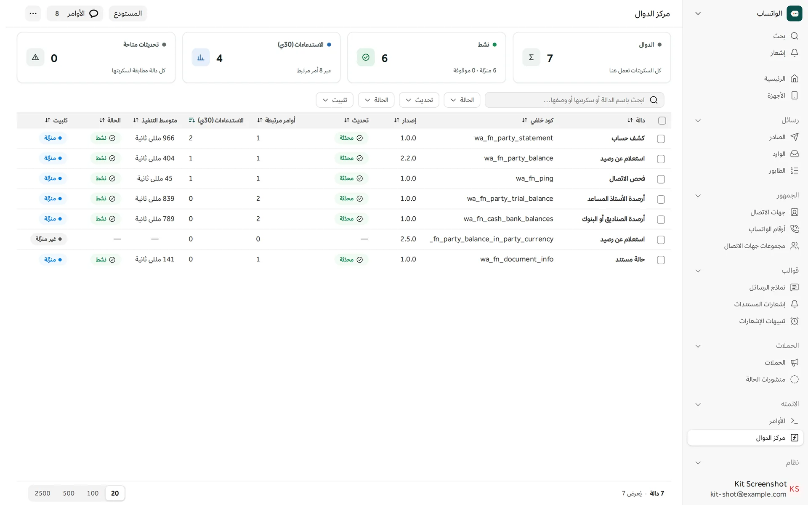
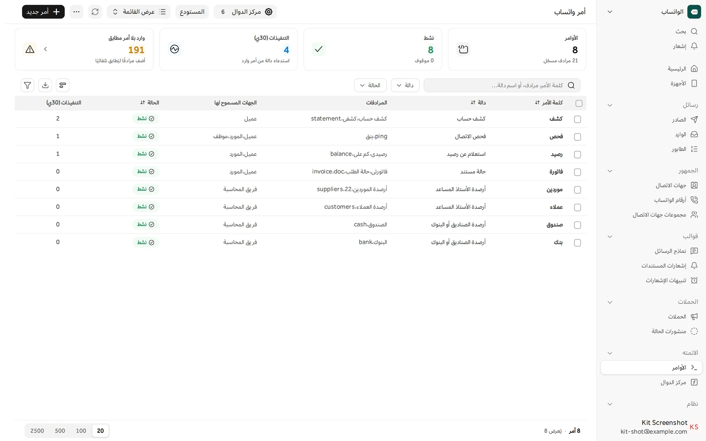
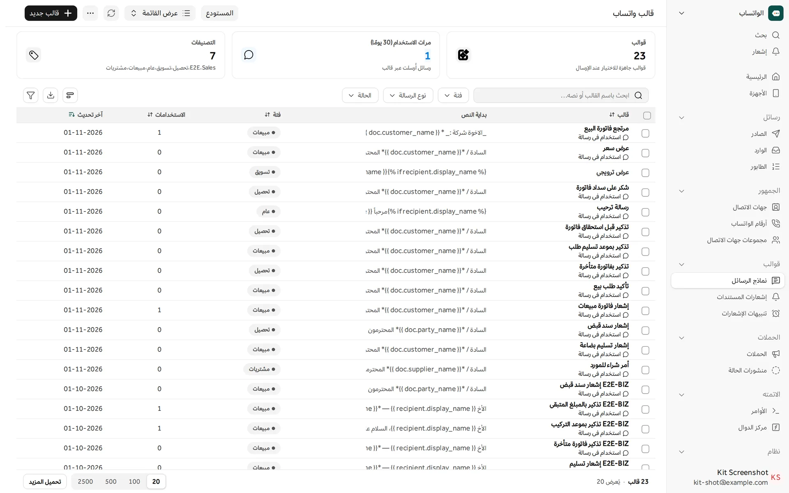
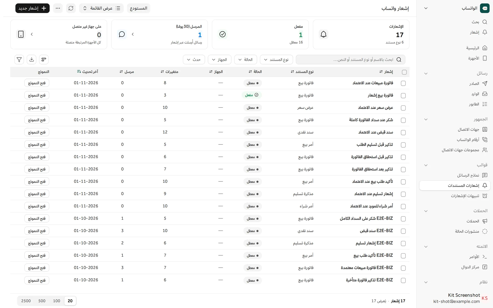
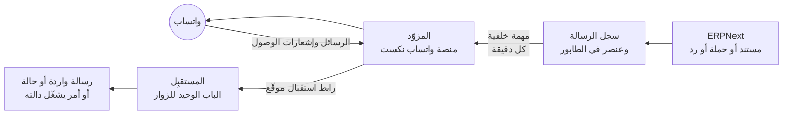

<div align="center">

<picture>
  <source media="(prefers-color-scheme: dark)" srcset=".github/readme/lockup-arabic-on-dark.svg">
  
</picture>

### واتساب داخل ERPNext

أرسل الفواتير وكشوف الحساب والتذكيرات على واتساب، وأطلق الحملات، واحفظ كل محادثة في نظامك،
ودع عميلك يطلب رصيده بكلمة واحدة.

[](https://github.com/frappe/frappe)
[](BRANCHES.md)
[](https://github.com/frappe/erpnext)
[](pyproject.toml)
[](license.txt)

[English](README.md) · **العربية** · [الموقع](https://whatsappnext.app) · [وثائق المطورين](developer-docs/README.md)

</div>

<br>



<div dir="rtl">

## ما هو واتساب نكست

واتساب نكست تطبيق على فرابي يربط ERPNext بواتساب. يضيف إلى النظام مساحة عمل باسم **الواتساب**
فيها شاشاته: الأجهزة، والصادر والوارد، وطابور الإرسال، والحملات، والقوالب، والإشعارات، والأوامر.
تخرج الرسائل عبر [منصة واتساب نكست](https://whatsappnext.app) من سند الرقمية. والتطبيق يكلّم
المنصة من خلال طبقة مزوّدين، فيمكن إضافة مزوّد آخر دون تغيير بقية التطبيق.

نظامك هو المرجع: كل رسالة، وكل إشعار وصول وقراءة، وكل رد، يُحفظ في موقعك أنت.

## المزايا

<table dir="rtl">
<tr>
<td width="50%" valign="top">
<br>
<b>جاهز في دقائق</b><br>
أنشئ حسابك أو سجّل دخولك من معالج داخل النظام. يرتبط الموقع بالمنصة وحده، ويسجّل رابط
الاستقبال، ويجلب أجهزتك الموجودة.
</td>
<td width="50%" valign="top">
<br>
<b>أكثر من رقم</b><br>
اربط أرقام واتساب بقدر ما تسمح باقتك، برمز QR أو برمز من 8 أرقام. لكل جهاز حالته وما أرسله
ونسبة الفشل فيه.
</td>
</tr>
<tr>
<td valign="top">
<br>
<b>إرسال تثق به</b><br>
كل رسالة تمر بطابور وله حالة: إعادة المحاولة بمهلة تتزايد، وإيقاف واستئناف، وسرعة إرسال
بالدقيقة.
</td>
<td valign="top">
<br>
<b>وارد في مكان واحد</b><br>
تصل الرسائل الواردة وتحديثات الحالة عبر رابط استقبال موقّع، وترتبط بجهة الاتصال التي أرسلتها.
</td>
</tr>
<tr>
<td valign="top">
<br>
<b>الحملات ومنشورات الحالة</b><br>
راسل مجموعة جهات اتصال أو من تختارهم، وتابع المرسل والواصل والمقروء لحظة بلحظة. وجدول
منشورات الحالة أيضاً.
</td>
<td valign="top">
<br>
<b>القوالب</b><br>
رسائل تأخذ حقولها من المستند. وتأتي قوالب عربية جاهزة لشركة تجارية.
</td>
</tr>
<tr>
<td valign="top">
<br>
<b>إشعارات المستندات</b><br>
رسالة عند اعتماد فاتورة أو سند قبض، وقبل استحقاق الفاتورة وبعده، وعند تأكيد الطلب أو تسليمه،
ومعها ملف PDF.
</td>
<td valign="top">
<br>
<b>تنبيهات التقارير</b><br>
ملخصات تقارير مجدولة تصل المدير على واتساب: مبيعات اليوم، وأرصدة العملاء والموردين، وحركة
حسابات الأمس.
</td>
</tr>
<tr>
<td valign="top">
<br>
<b>الأوامر</b><br>
يرسل العميل كلمة مثل «كشف» فيصله كشف حسابه. لكل أمر مرادفات، وقائمة بمن يحق له استعماله.
</td>
<td valign="top">
<br>
<b>مركز الدوال</b><br>
ما يفعله الأمر سكربت تثبّته وتحدّثه وتجرّبه من شاشة واحدة. ولا يعمل أي أمر بصلاحية المدير
العام.
</td>
</tr>
<tr>
<td valign="top">
<br>
<b>جهات الاتصال والأرقام</b><br>
أرقام بالصيغة الدولية على جهات اتصال النظام، ومجموعات، واستيراد من Excel وvCard، وصلاحيات
لكل جهة.
</td>
<td valign="top">
<br>
<b>المحاكي ومختبر التجربة</b><br>
جرّب المحادثة دون هاتف، ثم افحص كل جزء من الإعداد برسائل حقيقية إلى أرقام تختارها.
</td>
</tr>
<tr>
<td valign="top">
<br>
<b>آمن من البداية</b><br>
روابط استقبال موقّعة، وأربعة أدوار، وكل إرسال في مهمة خلفية، وباب واحد فقط مفتوح للزوار.
</td>
<td valign="top">
<br>
<b>عربي وإنجليزي</b><br>
كل شاشة تعمل من اليمين إلى اليسار ومن اليسار إلى اليمين، في الوضع الفاتح والداكن.
</td>
</tr>
</table>

## الشاشات

<table dir="rtl">
<tr>
<td width="50%"><br><sub><b>الأجهزة</b>: كل رقم بحالته وآخر 30 يوماً من عمله</sub></td>
<td width="50%"><br><sub><b>الحملات</b>: التقدم ونسب التوصيل والقراءة لكل حملة</sub></td>
</tr>
<tr>
<td><br><sub><b>مركز الدوال</b>: السكربتات التي تنفذ الأوامر، بإصداراتها وزمن تشغيلها</sub></td>
<td><br><sub><b>الأوامر</b>: الكلمات التي يرسلها العملاء ومرادفاتها ومن يحق له استعمالها</sub></td>
</tr>
<tr>
<td><br><sub><b>نماذج الرسائل</b>: بحقول المستند، مرتبة حسب الفئة</sub></td>
<td><br><sub><b>إشعارات المستندات</b>: أي مستند، وعند أي حدث، ومن أي جهاز</sub></td>
</tr>
</table>

## كيف يعمل

</div>



<div dir="rtl">

1. يكتب حدثٌ في مستند، أو حملة، أو موظف، سجلَّ رسالة وعنصراً في الطابور.
2. ترسل مهمة خلفية الطابور على دفعات عبر المزوّد، بالسرعة التي تحددها.
3. ترجع المنصة إلى موقعك بالرسائل الواردة وإشعارات الوصول والقراءة. ويتحقق المستقبِل من التوقيع
   ويحذف المكرر قبل أن يحفظ شيئاً.
4. الرسالة الواردة التي تطابق أمراً تشغّل دالته، بمستخدم الأوامر لا بالمدير العام.

الصورة الكاملة في [developer-docs/architecture.md](developer-docs/architecture.md).

## المتطلبات

| يحتاج | الإصدار |
|---|---|
| فرابي وERPNext | الإصدار 16 على فرع `version-16`، والإصدار 15 على فرع `version-15` ([BRANCHES.md](BRANCHES.md)) |
| بايثون | 3.10 أو أحدث |
| حساب واتساب | على [منصة واتساب نكست](https://whatsappnext.app)، وينشئه لك المعالج |

## التثبيت

</div>

```bash
cd $PATH_TO_YOUR_BENCH
bench get-app https://github.com/SANAD-Digital/whatsapp_next --branch version-16   # version-15 على فرابي 15
bench --site <site> install-app whatsapp_next
bench --site <site> migrate
bench build --app whatsapp_next
```

<div dir="rtl">

بعدها افتح **الواتساب** في النظام. يفتح معالج الإعداد وحده حتى يرتبط الموقع: أنشئ حساباً أو
سجّل دخولك، ووافق على الشروط، واربط رقمك الأول.

يضيف `bench migrate` حقل `Contact Phone.wa_phone_e164`، ويجلب المحتوى الجاهز: قوالب وإشعارات
وتنبيهات تقارير عربية لشركة تجارية. تصل الإشعارات والتنبيهات الجاهزة **مطفأة**، وما تشغّله أو
تعدّله يبقى كما هو بعد كل تحديث. التفاصيل في
[developer-docs/standard-content.md](developer-docs/standard-content.md).

ينشئ التثبيت أربعة أدوار (`WhatsApp Manager` و`WhatsApp Agent` و`WhatsApp Viewer`
و`WhatsApp Contact User`)، ومستخدماً للأوامر **معطلاً** (`wa-commands@<site>`). فعّله وامنحه ما
تحتاجه دوالك فقط قبل أن تستعمل الأوامر.

### الخطوط

هوية واتساب نكست بخطين: **IBM Plex Sans Arabic** للعربي و**Sora** للاتيني، وكلاهما برخصة
SIL Open Font License 1.1.

- **في المتصفح لا تثبّت شيئاً.** التطبيق يحملهما معه في `whatsapp_next/public/fonts/`.
- **على الخادم ثبّتهما مرة واحدة.** الخادم يرسم ملفات PDF التي ترافق الرسائل (الفواتير والكشوف
  وقوالب الطباعة) دون متصفح، وبدون الخطين يظهر الـ PDF العربي بأي خط يجده الخادم.

</div>

```bash
# بالمستخدم الذي يشغّل الـ bench
apps/whatsapp_next/scripts/install_fonts.sh                # → ~/.local/share/fonts/whatsappnext
# أو لكل مستخدمي الجهاز
sudo apps/whatsapp_next/scripts/install_fonts.sh --system  # → /usr/local/share/fonts/whatsappnext
```

<div dir="rtl">

السكربت ينزّل الخطين ورخصتيهما من مستودع Google Fonts الرسمي ويحدّث ذاكرة الخطوط. يحتاج `curl`
و`fontconfig`، وتشغيله مرة ثانية لا يضر. تأكد بالأمر `fc-list | grep -E "IBM Plex Sans Arabic|Sora"`،
وأعد تشغيل الـ bench إن كانت ملفات PDF قد رُسمت قبل ذلك.

## الوثائق

وثائق المطورين بالإنجليزية، ما عدا شرح الأوامر والدوال فهو بالعربية.

| الدليل | ما فيه |
|---|---|
| [التثبيت والإعداد](developer-docs/install-and-configure.md) | ما يفعله التثبيت والتحديث، والمعالج، وكل إعداد، والمهام والجدولة |
| [البنية](developer-docs/architecture.md) | الطبقات والجداول وحالات الطابور والتحديث اللحظي |
| [الأوامر والدوال](developer-docs/commands-and-functions.md) | من الكلمة الواردة إلى رد السكربت، وكيف يبقى ذلك آمناً |
| [واجهة البرمجة](developer-docs/api/README.md) | كل نقطة اتصال، مرتبة حسب المجال |
| [إضافة مزوّد](developer-docs/add-a-provider.md) | كتابة مزوّد جديد وتسجيله |
| [الصلاحيات](developer-docs/permissions.md) | الأدوار وما يستطيعه كل دور |
| [مختبر التجربة](developer-docs/test-lab.md) | فحص الإعداد كله برسائل حقيقية |
| [حل المشكلات](developer-docs/troubleshooting.md) | العَرَض والسبب والحل |

## للمطورين

</div>

```bash
cd $PATH_TO_YOUR_BENCH
bench --site <site> run-tests --app whatsapp_next
```

<div dir="rtl">

لا يتصل أي اختبار بالمنصة الحقيقية: يُستبدل المزوّد في الاختبارات بمزوّد وهمي. كل العمل على
`main`، وطريقة وصول التعديل إلى `version-16` و`version-15` في [BRANCHES.md](BRANCHES.md). وقواعد
الكود والترجمة في [developer-docs/CONTRIBUTING.md](developer-docs/CONTRIBUTING.md)، والتغييرات في
[CHANGELOG.md](CHANGELOG.md).

## الترخيص

الكود منشور برخصة [MIT](license.txt)، © 2026 سند الرقمية (Sanad Digital).

الخطوط في `brand/fonts/` و`whatsapp_next/public/fonts/` برخصة SIL Open Font License 1.1.
وأيقونات المزايا في هذه الصفحة من [Lucide](https://lucide.dev) برخصة ISC.

واتساب علامة تجارية لشركة WhatsApp LLC. واتساب نكست ليس تابعاً لشركة WhatsApp LLC ولا لشركة
Meta Platforms, Inc.، ولا معتمداً منهما.

</div>

<div align="center">
<br>
<br>
<sub>من <a href="https://sanad.digital">سند الرقمية</a></sub>
</div>
