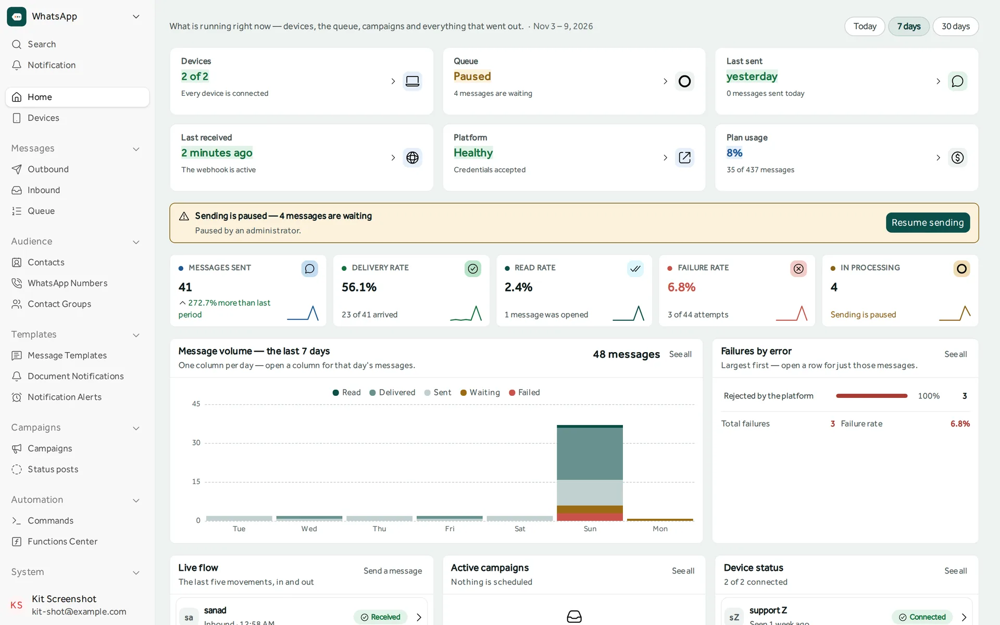
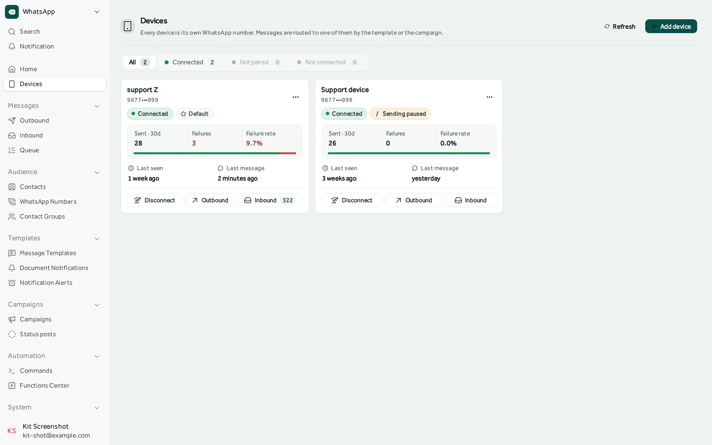
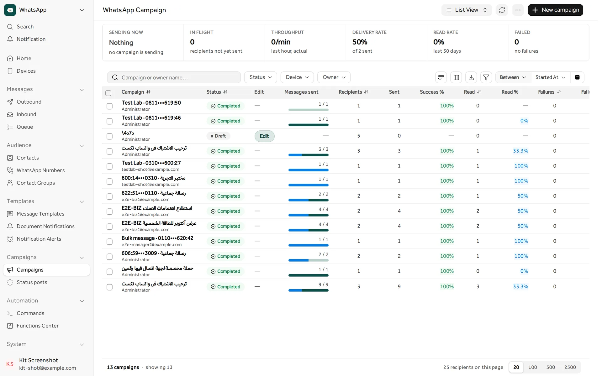
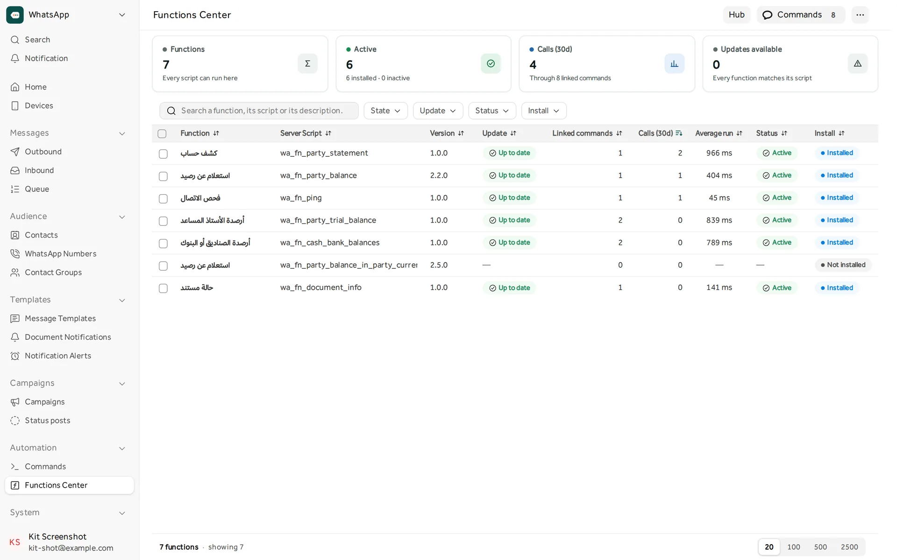
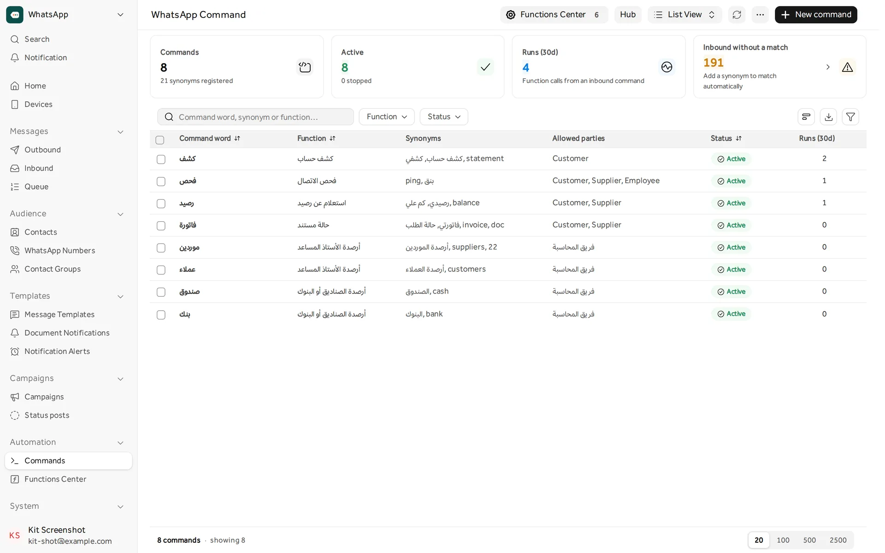
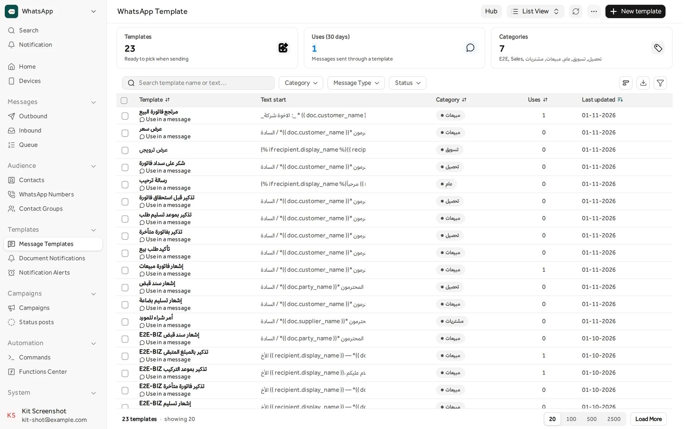
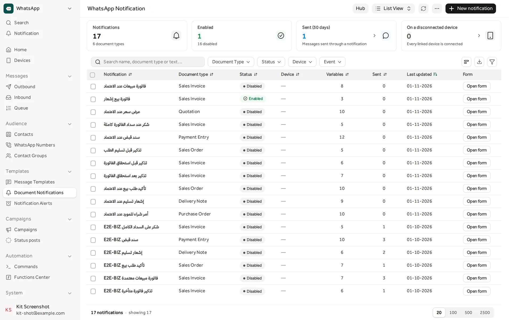
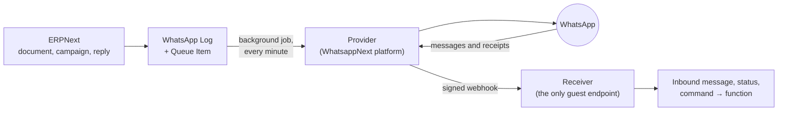

<div align="center">

<picture>
  <source media="(prefers-color-scheme: dark)" srcset=".github/readme/lockup-horizontal-on-dark.svg">
  
</picture>

### WhatsApp for ERPNext, built into the Desk

Send invoices, statements and reminders on WhatsApp, run campaigns, keep every conversation in
ERPNext, and let your customers ask for their own balance with one word.

[](https://github.com/frappe/frappe)
[](BRANCHES.md)
[](https://github.com/frappe/erpnext)
[](pyproject.toml)
[](license.txt)

**English** · [العربية](README.ar.md) · [Website](https://whatsappnext.app) · [Developer docs](developer-docs/README.md)

</div>

<br>



## What it is

WhatsappNext is a Frappe app that connects ERPNext to WhatsApp. It adds a **WhatsApp** workspace
to the Desk with its own screens: devices, outbound and inbound messages, the send queue,
campaigns, templates, notifications and commands. Messages go out through the
[WhatsappNext platform](https://whatsappnext.app) by Sanad Digital. The app talks to the platform
through a provider layer, so another provider can be added without touching the rest.

ERPNext stays the system of record: every message, every delivery and read receipt, and every
reply is stored on your own site.

## Features

<table>
<tr>
<td width="50%" valign="top">
<br>
<b>Ready in minutes</b><br>
Sign up or sign in from a wizard inside ERPNext. The site links itself to the platform,
registers its webhook and brings in the devices you already have.
</td>
<td width="50%" valign="top">
<br>
<b>Several numbers</b><br>
Link as many WhatsApp numbers as your plan allows, by QR code or an 8-digit code. Each device
shows its state, what it sent and its failure rate.
</td>
</tr>
<tr>
<td valign="top">
<br>
<b>Sending you can trust</b><br>
Every message goes through a queue with a status: retries with back-off, pause and resume, and a
send rate per minute. Nothing is sent from the request itself.
</td>
<td valign="top">
<br>
<b>One inbox</b><br>
Incoming messages and status updates arrive by a signed webhook and are linked to the contact
they came from.
</td>
</tr>
<tr>
<td valign="top">
<br>
<b>Campaigns and status posts</b><br>
Write to a contact group or to recipients you pick, and follow sent, delivered and read as they
happen. Schedule posts to your WhatsApp status too.
</td>
<td valign="top">
<br>
<b>Templates</b><br>
Messages with fields from the document. Ready-made Arabic templates for a trading company
install from the platform's hub.
</td>
</tr>
<tr>
<td valign="top">
<br>
<b>Document notifications</b><br>
Send a message when an invoice or a payment entry is submitted, before and after an invoice is
due, or when an order is confirmed or delivered, with the PDF attached.
</td>
<td valign="top">
<br>
<b>Report alerts</b><br>
Scheduled report digests to managers on WhatsApp: daily sales, customer and supplier balances,
yesterday's ledger.
</td>
</tr>
<tr>
<td valign="top">
<br>
<b>Commands</b><br>
A customer sends a word such as «كشف» and gets their statement back. Each command has
synonyms and a list of who may use it.
</td>
<td valign="top">
<br>
<b>Functions Center</b><br>
What a command does is a Server Script you install, update and try from one screen. Commands
never run as Administrator.
</td>
</tr>
<tr>
<td valign="top">
<br>
<b>Contacts and numbers</b><br>
Numbers kept in international format on ERPNext contacts, contact groups, import from Excel and
vCard, and per-contact permissions.
</td>
<td valign="top">
<br>
<b>Simulator and Test Lab</b><br>
Try a conversation without a phone, then check every part of the setup with real messages to
numbers you choose.
</td>
</tr>
<tr>
<td valign="top">
<br>
<b>Secure by default</b><br>
Signed webhooks, four roles, background jobs for every outbound call, and a single guest
endpoint.
</td>
<td valign="top">
<br>
<b>Arabic and English</b><br>
Every screen works right to left and left to right, in light and dark.
</td>
</tr>
</table>

## Screens

<table>
<tr>
<td width="50%"><br><sub><b>Devices</b>: each number with its state and its last 30 days</sub></td>
<td width="50%"><br><sub><b>Campaigns</b>: progress, delivery and read rates per campaign</sub></td>
</tr>
<tr>
<td><br><sub><b>Functions Center</b>: the scripts behind commands, with versions and run times</sub></td>
<td><br><sub><b>Commands</b>: the words customers send, their synonyms and who may use them</sub></td>
</tr>
<tr>
<td><br><sub><b>Message templates</b>: with document fields, by category</sub></td>
<td><br><sub><b>Document notifications</b>: which document, which event, which device</sub></td>
</tr>
</table>

The screens in Arabic are in the [Arabic README](README.ar.md#الشاشات).

## How it works



1. A document event, a campaign or a person writes a log row and a queue item.
2. A job sends the queue in batches through the provider, at the rate you set.
3. The platform calls the site back with incoming messages and delivery and read receipts. The
   receiver checks the signature and drops duplicates before it stores anything.
4. An incoming message that matches a command runs its function, as the command service user.

The full picture is in [developer-docs/architecture.md](developer-docs/architecture.md).

## Requirements

| Needs | Version |
|---|---|
| Frappe and ERPNext | 16, on branch `version-16`; 15, on branch `version-15` ([BRANCHES.md](BRANCHES.md)) |
| Python | 3.10 or later |
| A WhatsApp account | On the [WhatsappNext platform](https://whatsappnext.app). The wizard creates one for you. |

## Installation

```bash
cd $PATH_TO_YOUR_BENCH
bench get-app https://github.com/SANAD-Digital/whatsapp_next --branch version-16   # version-15 on Frappe 15
bench --site <site> install-app whatsapp_next
bench --site <site> migrate
bench build --app whatsapp_next
```

Then open **WhatsApp** on the Desk. The setup wizard opens by itself until the site is linked:
create an account or sign in, accept the terms, and link your first number.

`bench migrate` adds the `Contact Phone.wa_phone_e164` field. Ready-made templates, notifications,
report alerts, commands and functions are not part of the app: open the **Hub** on any of those
screens and install what you need from the platform. Notifications and alerts arrive **switched
off**. See [developer-docs/ready-made-content.md](developer-docs/ready-made-content.md).

The install creates four roles (`WhatsApp Manager`, `WhatsApp Agent`, `WhatsApp Viewer`,
`WhatsApp Contact User`) and a **disabled** command service user (`wa-commands@<site>`). Enable it
and grant it only what your functions need before you use commands.

### PDFs drawn with Chrome

A Print Format whose **PDF Generator** is Chrome is drawn by the Chromium Frappe keeps in
`frappe-bench/chromium`, which needs system libraries a bare server lacks (`libnss3.so: cannot open
shared object file`, then "Chromium took too long to start"). On Frappe Cloud there is nothing to
do: its bench image carries these libraries and Chromium itself. On a bench you run yourself:

```bash
sudo apps/whatsapp_next/scripts/install_pdf_deps.sh   # as root, from frappe-bench
bench setup-chrome && bench restart                    # as the bench user
```

Without them the app still sends the PDF: it falls back to wkhtmltopdf, but a format made for
Chrome looks right only in Chrome.

### Fonts

The WhatsappNext identity uses **IBM Plex Sans Arabic** (Arabic) and **Sora** (Latin), both under
the SIL Open Font License 1.1.

- **In the browser, nothing to install.** The app ships them as woff2 in
  `whatsapp_next/public/fonts/` (the originals are in `brand/fonts/`).
- **On the server, install them once.** The server draws the PDFs it attaches to messages
  (invoices, statements, print formats) without a browser. Without the fonts, an Arabic PDF falls
  back to whatever font the server has.

```bash
# as the user the bench runs as (the one that renders PDFs)
apps/whatsapp_next/scripts/install_fonts.sh                # → ~/.local/share/fonts/whatsappnext
# or for every user on the machine
sudo apps/whatsapp_next/scripts/install_fonts.sh --system  # → /usr/local/share/fonts/whatsappnext
```

The script downloads the fonts and their licences from the official Google Fonts repository and
refreshes the font cache. It needs `curl` and `fontconfig` and is safe to run again. Check with
`fc-list | grep -E "IBM Plex Sans Arabic|Sora"`, and restart the bench if PDFs were made before.

## Documentation

| Guide | What it covers |
|---|---|
| [Install and configure](developer-docs/install-and-configure.md) | What install and migrate do, the wizard, every setting, workers and scheduler |
| [Architecture](developer-docs/architecture.md) | Layers, DocTypes, queue states, realtime |
| [Commands and functions](developer-docs/commands-and-functions.md) | From an incoming word to a script's answer, and how it stays safe |
| [API](developer-docs/api/README.md) | Every whitelisted endpoint, by area |
| [Add a provider](developer-docs/add-a-provider.md) | Writing and registering a new provider |
| [Permissions](developer-docs/permissions.md) | Roles and what each one can do |
| [Test Lab](developer-docs/test-lab.md) | Testing the whole setup with real messages |
| [Troubleshooting](developer-docs/troubleshooting.md) | Symptom, cause, fix |

## Development

```bash
cd $PATH_TO_YOUR_BENCH
bench --site <site> run-tests --app whatsapp_next
```

No test calls the real platform: providers are swapped through the registry with a
`FakeProvider`. All work goes to `main`; how a change reaches `version-16` and `version-15` is in
[BRANCHES.md](BRANCHES.md). Code rules, commits and translations are in
[developer-docs/CONTRIBUTING.md](developer-docs/CONTRIBUTING.md), and changes in
[CHANGELOG.md](CHANGELOG.md).

<details>
<summary>Where things live</summary>

```
whatsapp_next/
  hooks.py                  provider registry, fixtures, doc events, scheduler
  install.py                the command service user; everything else is a file Frappe syncs
  providers/                base contract, registry, snd_platform, meta_cloud skeleton
  services/                 business logic (phone, dispatch, read layer, audit, ...)
  api/v1/                   whitelisted endpoints, one module per area
  webhooks/v1/              inbound receiver (guest), verify, idempotency
  whatsapp_next/doctype/    module "WhatsApp Next": thin controllers
  whatsapp_next/page/       the wa-* screens
  public/js/ui/             the portable component kit (sanad.ui)
  fixtures/                 roles and one HTML block
  translations/ar.csv       Arabic
  tests/                    the app test suite
brand/                      logo, icon, fonts and colour tokens
developer-docs/             developer documentation
```

</details>

## License

The code is released under the [MIT License](license.txt), © 2026 Sanad Digital.

The fonts in `brand/fonts/` and `whatsapp_next/public/fonts/` are under the SIL Open Font License
1.1. The feature icons in this README are drawn from [Lucide](https://lucide.dev) (ISC License).

WhatsApp is a trademark of WhatsApp LLC. WhatsappNext is not affiliated with or endorsed by
WhatsApp LLC or Meta Platforms, Inc.

<div align="center">
<br>
<br>
<sub>Made by <a href="https://sanad.digital">Sanad Digital</a></sub>
</div>
