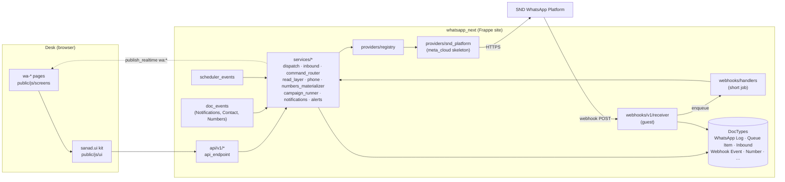
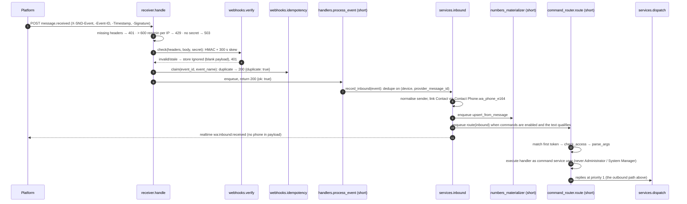

# Architecture

This page covers how `whatsapp_next` is built: its layers, what each piece owns, and the path a
message takes in each direction. `plan/decisions.md` records the reasons (cited as D-###).

## Layers

| Layer | Path | Rule |
|---|---|---|
| DocType controllers | `whatsapp_next/whatsapp_next/doctype/*/` | Thin: validation and lifecycle only. No HTTP calls. Status fields are protected by the status-writer guard (D-038). |
| Services | `whatsapp_next/services/` | All business logic. Every document write, state change and audit row goes through a service (D-128). |
| Providers | `whatsapp_next/providers/` | Outbound I/O only. `BaseProvider` is the contract. `registry.py` resolves the active provider from the `whatsapp_providers` hook and `WhatsApp Settings.provider`, and nothing outside `providers/` imports a provider module. Every provider error is raised as a `providers.exceptions.*` type. |
| API | `whatsapp_next/api/v1/<area>.py` | Endpoints wrapped in `api._common.api_endpoint` (D-039): role check, typed arguments, provider errors mapped to `WA*` errors. The only logic allowed here is the list of writable fields, bulk orchestration (`_bulk.run_bulk`) and shaping read-only query results (D-128). |
| Webhooks | `whatsapp_next/webhooks/v1/receiver.py` + `verify.py`, `idempotency.py`, `handlers.py` | The only guest endpoint. It checks the delivery, removes duplicates, stores the event and hands the rest to a job. |
| Desk pages | `whatsapp_next/whatsapp_next/page/wa_*` | `wa-home`, `wa-onboarding`, `wa-devices`, `wa-contacts`, `wa-functions-center`, `wa-simulator`, `wa-settings`. Every page takes its data from the API layer. |
| UI kit | `whatsapp_next/public/js/ui/` | Portable `sanad.ui` components. They call `sanad.ui.call("<area>.<fn>")`, and `public/js/whatsapp_next_setup.js` maps those keys to `whatsapp_next.api.v1.*` (D-056). See [kit/README.md](kit/README.md). |
| Screens, forms, lists | `public/js/screens/`, `public/js/form/`, `public/js/listview/` | App-specific JS, registered through `doctype_js` / `doctype_list_js` (D-057). |

The code contains no `frappe.db.sql`. Queries use `frappe.qb` or `frappe.get_all`. The rule: raw
SQL only when `frappe.qb` cannot express the query, with a decision recorded for it.

## Component diagram



## Outbound send

```mermaid
sequenceDiagram
  autonumber
  participant C as Caller (API / doc event / campaign)
  participant D as services.dispatch
  participant DB as DB
  participant S as Scheduler (dispatch_tick, every minute)
  participant J as short job dispatch_device_batch
  participant P as SndPlatformProvider
  participant PL as Platform
  participant R as webhooks.v1.receiver
  participant H as short job handlers.process_event

  C->>D: create_and_enqueue(OutboundSpec)
  D->>DB: WhatsApp Log (Unsent), checks: device, E.164/JID, blacklist, known-number policy, template
  D->>DB: WhatsApp Queue Item (Queued) + Log → Queued
  S->>J: enqueue per Connected, enabled device (job_id wa-dispatch-{device}), skipped while queue paused
  J->>DB: claim_batch: FOR UPDATE SKIP LOCKED, ≤ min(rate − sent this minute, 200), commit
  J->>P: send_batch(messages, batch_id)
  P->>PL: POST enqueue_messages_api (client_ref = Log name)
  PL-->>P: per-message accept / reject
  P-->>J: BatchResult
  J->>DB: accepted → Queue Item Completed, Log Sending/Held; error → retry with back-off or Dead Letter
  J-->>C: realtime wa:queue:progress, wa:message:status
  PL->>R: POST message.sent / delivered / read / failed / held
  R->>R: headers, rate limit, secret, HMAC + freshness, parse
  R->>DB: WhatsApp Webhook Event (unique event_name + event_id)
  R->>H: enqueue (job_id wa-webhook-{event_id})
  H->>D: apply_status(outbound, status) (forward-only)
  D-->>C: realtime wa:message:status
```

Notes:

- The Log row is found by `client_ref` (the Log name), or else by `provider_message_id`
  (`handlers._resolve_outbound`).
- `apply_status` only moves a message forward, in the order `Unsent < Queued < Sending/Held < Sent
  < Delivered < Read`. `Failed` and `Cancelled` are final (D-046).
- Every five minutes `reconcile_statuses` catches anything the webhooks missed: it asks the
  provider for status (`get_message_status`), puts claims stuck in `Sending` longer than 10 minutes
  back in the queue, fixes drift between Log and Queue Item, resolves holds older than 7 days and
  finalises campaigns.

## Inbound message



Routing starts only when `WhatsApp Settings.enable_commands` is on and the message is text. In a
direct chat any text is routed. In a group only text starting with `#`, `/` or `!` is routed
(`inbound.should_route`). `check_access` answers with the first failing reason, in this fixed
order: commands disabled → not text → global blacklist → blocked group → allowed group → requires
linked contact → party types → the party type's allow/deny list → function inactive.

## DocTypes

| DocType | Kind | Purpose |
|---|---|---|
| WhatsApp Settings | Single | Provider, credentials, webhook, queue, commands, policy, retention, subscription cache, onboarding. See [install-and-configure.md](install-and-configure.md#6-whatsapp-settings-fields). |
| WhatsApp Device | `WA-DEV-.###` | A WhatsApp number paired on the provider. `status`: Pending QR / Connected / Disconnected / Logged Out. A row is inserted only inside `status_writer()`, because the device must exist on the provider first (D-112). |
| WhatsApp Log | hash | One **outbound** message (the name kept from the legacy app, D-027). Status: Unsent / Queued / Sending / Sent / Delivered / Read / Failed / Cancelled / Held. `source_type` records who sent it (Quick Send, Form, Campaign, Notification, Notification Alert, Command Reply, Simulator, API). |
| WhatsApp Queue Item | hash | The dispatch state of one Log (1:1), split out the same way Frappe splits `Communication` / `Email Queue` (D-027). |
| WhatsApp Inbound Message | hash | One received message or reaction. `command_status` records what the router did with it. |
| WhatsApp Webhook Event | hash | Every delivery the receiver accepted or rejected, kept for idempotency and forensics. Status: Received / Processed / Ignored / Failed. |
| WhatsApp Number | named by `phone_e164` | One row per number or JID seen in either direction. A stored `DISTINCT`, derived data rather than the source of truth. `number_type` is Individual / Group / LID; `link_status` is Linked / Not Linked. |
| WhatsApp Campaign (+ Campaign Message, Campaign Recipient) | `WA-CAMP-.YYYY.-.#####` | A bulk send with its messages and recipients. Status: Draft → Scheduled / Queued → Running ↔ Paused → Completed / Partially Failed / Cancelled (`campaign_runner._TRANSITIONS`). |
| WhatsApp Contact Group (+ Member) | `group_name` | Lists of recipients. `kind = Blacklist` makes the group usable as the global or per-command blacklist. |
| WhatsApp Template | `template_name` | Reusable message bodies rendered through Frappe's Jinja environment (D-045). |
| WhatsApp Notification (+ Recipient) | `notification_name` | Sends fired by document events or dates, the way Frappe's own Notification works (D-016, D-049). |
| WhatsApp Notification Alert (+ Recipient) | `alert_name` | Report digests sent on a schedule (`next_run_at`), optionally as PDF (D-016, D-139). |
| WhatsApp Function (+ Function Setting, Function Output) | `function_key` | A catalog function installed on this site, with its settings and output templates (D-048). |
| WhatsApp Command (+ Command Access, Access Entry, Party Type) | `code` | An inbound command word bound to a Function, with access rules. Status: Active / Inactive. |
| WhatsApp Audit Log | hash | Audit trail of connect/disconnect, credential and settings changes, bulk sends, campaign actions, elevated contact reads and writes, function changes and retention purges. |
| WhatsApp Settings Picker Source | child | The DocTypes the ContactPicker may take recipients from. |

Log and derived tables appear in `ignore_links_on_delete`, so message history never blocks deleting
a device, contact or campaign (D-061).

## Status-writer guard

`services/guards.py`: `with status_writer():` sets a counter flag. `assert_status_writer(doc)` runs
in `validate` on Device, Log, Inbound (`command_status`), Queue Item, Campaign and Webhook Event.
It refuses a status change made outside that block with `WAStateConflictError` ("… can only be
changed by the system"). Inserts are not guarded. `services/dispatch.py` is the **single status
writer** for Log and Queue Item (D-046).

## Unified read layer

`services/read_layer.py` is the **only** place where outbound (`WhatsApp Log`) and inbound
(`WhatsApp Inbound Message`) are read together, and it holds the only `UNION` in the codebase
(D-043):

- Both tables are projected onto one shared column set (`COLUMNS`) and combined with a `frappe.qb`
  `UNION ALL`. No raw SQL is involved.
- Each branch is filtered by key, device and time, and ordered and limited, **before** the union.
- Paging uses a key set on `(ts, name)` with an opaque cursor. `conversation()` returns
  `{rows, has_more}`.
- The key is the outbound `phone_e164`, or the `jid` for groups. For inbound it is the `chat_jid`
  for groups, else `phone_e164`, else `sender_jid` (LID senders).
- Callers: `conversation`, `cross_direction_rows`, `iter_keys_since` (Numbers job), `known_keys`
  (the ContactPicker's known-number flag and the known-number policy), `stats_by_key`,
  `device_stats`.

Anything else that needs "messages in both directions" must call this module.

## E.164 normalisation

`services/phone.py` is the single normaliser. Every phone written into a DocType and every
comparison between phones goes through `normalize(raw, region=None)`:

- It strips spaces, `-`, `()`, `.` and bidi marks. Arabic-Indic digits become ASCII, and `00`
  becomes `+`.
- `@c.us` and `@s.whatsapp.net` JIDs become E.164. **Group (`@g.us`) and LID (`@lid`) JIDs are
  returned unchanged.**
- A number with a leading `0` is parsed in the default region (`WhatsApp Settings.default_country`,
  falling back to `SA`). A bare run of digits is tried as international first, then as national.
- An invalid number returns `None`, and callers raise `WAInvalidPhoneError`.
- `to_provider()` strips the `+` only at the provider boundary.

Core Contacts are matched through the custom field `Contact Phone.wa_phone_e164`. The
`Contact.validate` hook (`sync_contact_phones`) keeps it filled (D-028); a Contact that existed
before the app was installed gets the value at its next save. Phone fields in the app's own
DocTypes are always named `phone` (raw) and `phone_e164` (normalised, indexed).

## WhatsApp Numbers materialisation

`services/numbers_materializer.py` keeps `WhatsApp Number` up to date through three entry points.
All three **assign** values from a fresh aggregate (`read_layer.stats_by_key`) and never increment
them, so any of them can run again safely:

| Entry point | When | What |
|---|---|---|
| `on_message_insert` | `after_insert` of WhatsApp Log / WhatsApp Inbound Message (`doc_events`) | Enqueues `upsert_from_message` after commit, with one job per key deduplicated by `job_id` `wa-num-<sha1>`. Never runs in the request. |
| `nightly_reconcile` | cron `30 2 * * *` | Visits only keys whose messages are newer than `WhatsApp Settings.numbers_watermark` (minus a 60 s overlap), recomputes them, commits per batch, runs a drift check and then advances `numbers_watermark` and `numbers_last_run_at`. `full=True` ignores the watermark. |
| `refresh_group_name` | `group.updated` / `group.participants.updated` webhooks | Updates the display name of a Group row. |

## Queue states and dead letter

`WhatsApp Queue Item.status`: `Queued`, `Sending`, `Paused`, `Deleted`, `Completed`, `Dead Letter`.
Deleting a queue item is a state change, never a row removal. Retention later purges terminal
items (`Completed`, `Deleted`, `Dead Letter`).

| Outcome of a batch | Effect |
|---|---|
| Accepted | Queue Item → `Completed`. The Log stays `Sending` (or `Held`) until a webhook moves it on. |
| Per-message error, retryable (`device_disconnected`, `timeout`, `rate_limited`) | `attempts + 1`, `next_attempt_at = now + retry_backoff_seconds · 2^(attempts−1) ± 10 %` |
| Per-message error, not retryable or `max_attempts` reached | `Dead Letter`, Log `Failed` with `error_code` |
| Whole call fails | Every claimed row goes back to `Queued` with back-off and `attempts` unchanged. `DeviceOfflineError` marks the device `Disconnected`. `AuthError` sets Settings `connection_status = Failed`. |

Error codes come from `services/errors.classify`, which maps provider exceptions, platform codes
and provider error text onto `WhatsApp Log.error_code` (see [troubleshooting.md](troubleshooting.md)).
Priority depends on the source: Quick Send / Command Reply / Form / Simulator get 1, API /
Notification / Alert get 3, Campaign gets 5 (D-046). Pausing works globally
(`WhatsApp Settings.queue_paused`, which makes `dispatch_tick` do nothing) or per item
(`pause_items` / `resume_items`). `retry_dead_letter` puts items back in the queue.

## Realtime events

Every event is published with `after_commit=True`, except `wa:import:progress`, and no payload
carries a phone number. The full payload table is in
[events-and-hooks.md](events-and-hooks.md#realtime-events-wa).

| Event | Published by |
|---|---|
| `wa:device:status` | `services/devices.py` |
| `wa:pairing:status` | `services/devices.start_pairing` (user room) |
| `wa:message:status` | `services/dispatch.py` |
| `wa:queue:progress` | `services/dispatch.publish_progress` (at most one per second per device) |
| `wa:inbound:received` | `services/inbound.py` |
| `wa:campaign:status` | `services/campaign_runner.py` |
| `wa:import:progress` | `services/picker.parse_upload` (user room) |

## Scheduler jobs

| Schedule | Job | Purpose |
|---|---|---|
| every minute | `services.dispatch.dispatch_tick` | Enqueue one `dispatch_device_batch` per Connected device |
| every minute | `services.campaign_runner.promote_scheduled` | Start `Scheduled` campaigns that are due |
| `*/5` | `services.reconcile.reconcile_statuses` | Status lookup, stale claims, drift, expired holds, campaign finalisation |
| `*/5` | `services.notifications.trigger_offset` | Minutes Before / After notifications |
| `*/10` | `webhooks.handlers.reprocess_failed` | Retry `Failed` webhook events (up to 3 tries) |
| `*/15` | `services.alerts.run_due_alerts` | Enqueue due Notification Alerts (`long`) |
| `30 2 * * *` | `services.numbers_materializer.nightly_reconcile` | Numbers watermark job |
| `0 3 * * *` | `services.retention.purge` | Retention by the Settings `*_retention_days` fields |
| hourly | `services.devices.sync_from_provider` | Mirror device state (never creates devices) |
| hourly | `services.usage_sync.sync_subscription` | Plan, quota and wallet into Settings |
| hourly | `services.webhook_setup.sync_status` | Mirror endpoint state (Active / Disabled / Locked / Revoked) |
| daily | `services.notifications.trigger_daily` | Days Before / After notifications |
| daily | `services.functions_catalog.check_updates` | Flag functions that have updates |

Queues used by `frappe.enqueue` in the app: `short` for sends, webhook processing, the Numbers
upsert, command routing and notifications. `long` for campaign materialisation
(`campaign_runner.materialize` / `materialize_pending`) and alerts (`alerts.run_alert`). The
scheduler entries themselves run wherever Frappe's scheduler puts them.

## API versioning (D-031)

Frappe routes a whitelisted method by its dotted path, so the version is a package in that path:
`whatsapp_next.api.v1.<area>.<fn>` → `/api/method/whatsapp_next.api.v1.<area>.<fn>`. The receiver
is versioned the same way (`whatsapp_next.webhooks.v1.receiver.receive`).

- A breaking change goes into a new package (`api/v2/`). `v1` is then edited only for security
  fixes, and is removed only after a documented deprecation period.
- `api/_common.py`, `services/` and `providers/` do not depend on the API version.
- Frappe's own `/api/v1` and `/api/v2` URL prefixes are a protocol version and have nothing to do
  with this package version.

See [api/README.md](api/README.md) for the endpoint conventions.
